<picture><source media="(max-width: 600px) and (prefers-color-scheme: dark)" srcset="assets/hero-mobile-dark.svg"><source media="(max-width: 600px)" srcset="assets/hero-mobile-light.svg"><source media="(prefers-color-scheme: dark)" srcset="assets/hero-dark.svg"></picture>

<a href="https://th3web.com/author/"><picture><source media="(prefers-color-scheme: dark)" srcset="assets/social-1-dark.svg"></picture></a>&nbsp;<a href="https://t.me/th3_nek1t"><picture><source media="(prefers-color-scheme: dark)" srcset="assets/social-2-dark.svg"></picture></a>&nbsp;<a href="https://open.spotify.com/user/31cpmx7kalltfi2ol7xlccdbsdc24"><picture><source media="(prefers-color-scheme: dark)" srcset="assets/social-3-dark.svg"></picture></a>

<a href="https://github.com/Th3Nekit/Finegram"><picture><source media="(prefers-color-scheme: dark)" srcset="assets/project-finegram-dark.svg"></picture></a>&nbsp;<a href="https://github.com/Th3Nekit/Lean"><picture><source media="(prefers-color-scheme: dark)" srcset="assets/project-lean-dark.svg"></picture></a>

<a href="https://github.com/Th3Nekit/Th3ProxyTools"><picture><source media="(prefers-color-scheme: dark)" srcset="assets/project-th3proxytools-dark.svg"></picture></a>&nbsp;<a href="https://github.com/Th3Nekit/pc-control-telegram"><picture><source media="(prefers-color-scheme: dark)" srcset="assets/project-pc-control-telegram-dark.svg"></picture></a>

<a href="https://github.com/Th3Nekit/PinterestSaver"><picture><source media="(prefers-color-scheme: dark)" srcset="assets/project-pinterestsaver-dark.svg"></picture></a>&nbsp;<a href="https://github.com/Th3Nekit/Socks5Hotspot"><picture><source media="(prefers-color-scheme: dark)" srcset="assets/project-socks5hotspot-dark.svg"></picture></a>

<a href="https://github.com/Th3Nekit/FileConverter"><picture><source media="(prefers-color-scheme: dark)" srcset="assets/project-fileconverter-dark.svg"></picture></a>

<picture><source media="(max-width: 600px) and (prefers-color-scheme: dark)" srcset="assets/stack-mobile-dark.svg"><source media="(max-width: 600px)" srcset="assets/stack-mobile-light.svg"><source media="(prefers-color-scheme: dark)" srcset="assets/stack-dark.svg"></picture>

<a href="https://github.com/Th3Nekit?tab=repositories"><picture><source media="(prefers-color-scheme: dark)" srcset="assets/button-1-dark.svg"></picture></a>&nbsp;&nbsp;<a href="https://www.donationalerts.com/c/th3_nekit"><picture><source media="(prefers-color-scheme: dark)" srcset="assets/button-2-dark.svg"></picture></a>

<picture><source media="(prefers-color-scheme: dark)" srcset="assets/wave-dark.svg"></picture>

<a href="https://metawka.github.io/expressive-profile/?from=Th3Nekit"><picture><source media="(prefers-color-scheme: dark)" srcset="assets/credit-dark.svg"></picture></a>

